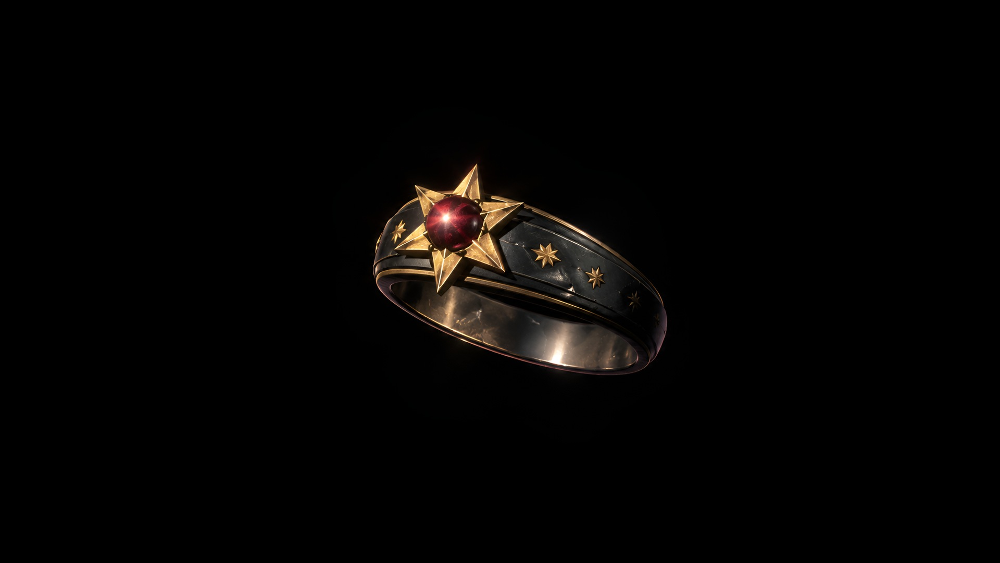
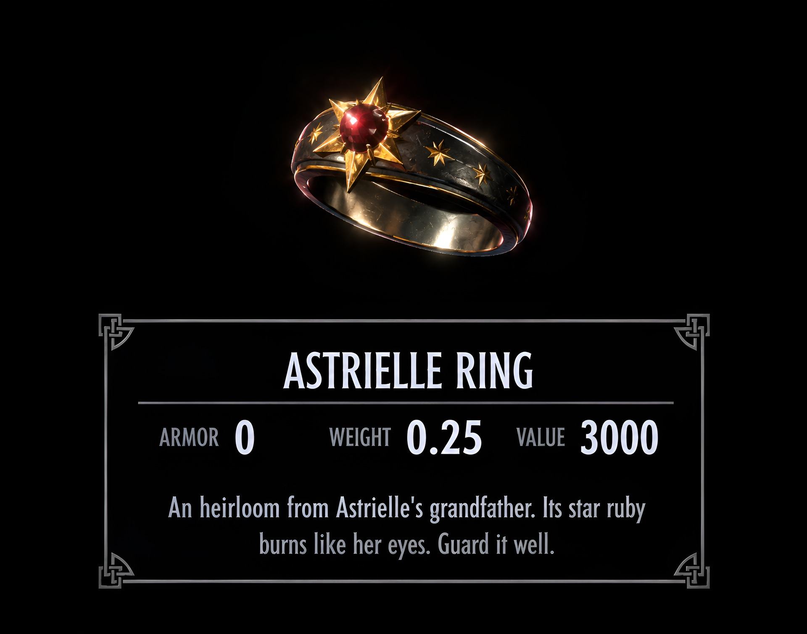

# Tinesh's Astrielle Ring - A Star Ruby Ring for Skyrim SE/AE

Astrielle is my own character in Skyrim, a red-eyed High Elf often taken for a Dunmer, and this is the ring she wears;
the mod is named after her. In the game it is a family heirloom: a band of blackened silver inlaid with golden stars, set with a star ruby in
a six-pointed golden star. One ring does the work of a full set of enchanted jewelry: faster regeneration, faster
learning, combat and magic bonuses, better prices, more carry weight, faster movement and no falling damage. It lies on
a table in the Sleeping Giant Inn, in Riverwood.


**[Download the latest release](https://github.com/71Kevin/astrielle-ring-se/releases/latest)**: one package with 4K
textures, see [Downloads](#downloads).

## Features

- **One original ring**, modelled and textured from scratch: blackened silver, gold inlays, a golden star setting and
  a star ruby with a six-rayed star.
- **Astrielle's Grace**: a constant enchantment with 32 effects, listed in full under [Effects](#effects).
- **Fitted to the finger**: the worn ring is measured on the index finger of the CBBE 3BA female hands and the vanilla
  male hands, and checked in idle, walking and combat poses.
- **Its own description** in the inventory, like a unique artifact.
- **No visual effect on the character**: equipping the ring shows no glow or shader.
- **4K textures**, BC7 with mipmaps.
- ESL-flagged plugin; the only master is `Skyrim.esm`.

<p align="center">
  
  
</p>

## Downloads

| Package | Textures | Download (version 1.0) |
|---|---|---|
| Astrielle Ring | Ring 4096 × 2048 px, gem 2048 × 2048 px | [Astrielle-Ring-1.0.zip](https://github.com/71Kevin/astrielle-ring-se/releases/download/v1.0/Astrielle-Ring-1.0.zip) (6.5 MB) |

Release notes and SHA-256 checksums: [v1.0](https://github.com/71Kevin/astrielle-ring-se/releases/tag/v1.0). Changes:
[CHANGELOG.md](CHANGELOG.md).

The ring's metal has a diffuse map, a normal map and a reflection mask of 4096 × 2048 px, and the gem a diffuse map
of 2048 × 2048 px; the gem's normal map and reflection mask are flat, so they are 256 × 256 px. All textures are BC7
with mipmaps.

### Mod pages

| Page | Link |
|---|---|
| GitHub Releases | [All releases](https://github.com/71Kevin/astrielle-ring-se/releases) |
| Nexus Mods | Coming soon |
| Dwemer Mods | Coming soon |

## Requirements

- Skyrim Special Edition or Anniversary Edition. Built and tested on version 1.6.1170.

Nothing else: no DLC, no SKSE and no other mods. The plugin's only master is `Skyrim.esm`, it has no scripts, and every
effect runs on the game's own mechanics.

## Installation

1. Install the package with your mod manager:
   - **Mod Organizer 2**: *Install a new mod from an archive* and pick the package.
   - **Vortex**: drag the package onto the *Mods* page (or use *Install From File*), then enable and deploy.
   - **Manual**: extract the package into the game's `Data` folder.
2. Enable `[Tinesh] Astrielle Ring.esp`. It is ESL-flagged, so it does not use a full load order slot.

The archive holds the `Data` folder's contents (the plugin, `meshes` and `textures`), so mod managers install it
without asking for a data folder. A new game is not needed: the ring is in the inn the next time you go there.

## Getting the ring

There is one Astrielle Ring in the world. Go to the **Sleeping Giant Inn in Riverwood**: the ring lies on a small
round table beside a horn candle and a bottle of Black-Briar Mead. It belongs to you, so taking it is not stealing.
It cannot be crafted or bought, and no quest or character gives it.

Console, if you would rather skip the trip: `help "astrielle ring" 4` shows the ring's ID, which starts with `FE` and
ends in `800` (the digits in between depend on your load order), then `player.additem <ID> 1`.
`coc RiverwoodSleepingGiantInn` takes you to the inn.

| Item | Slot / type | Armor | Weight | Value |
|---|---|---|---|---|
| Astrielle Ring | 36 (ring), clothing | 0 | 0.25 | 3000 |

Merchants buy it as jewelry. It cannot be disenchanted, so Astrielle's Grace cannot be learned or put on other items.

## Effects

Astrielle's Grace is a constant effect: everything below is active while the ring is worn. The inventory shows the
ring's description instead of the effect list, as with other unique artifacts; the effects are listed under
*Magic → Active Effects*.

| Effect | What it does |
|---|---|
| Regenerate Health | Health regenerates 100% faster |
| Regenerate Magicka | Magicka regenerates 100% faster |
| Regenerate Stamina | Stamina regenerates 100% faster |
| Astrielle's Learning | Skills improve 30% faster |
| Fortify One-Handed | One-handed attacks do 40% more damage |
| Fortify Light Armor | Light Armor skill +40 |
| Fortify Two-Handed | Two-handed attacks do 30% more damage |
| Fortify Archery | Bows do 30% more damage |
| Fortify Blocking | Block 30% more damage with your shield |
| Fortify Alteration | Alteration spells cost 25% less to cast |
| Fortify Conjuration | Conjuration spells cost 25% less to cast |
| Fortify Destruction | Destruction spells cost 25% less to cast |
| Fortify Illusion | Illusion spells cost 25% less to cast |
| Fortify Restoration | Restoration spells cost 25% less to cast |
| Empower Alteration | Alteration spells last 25% longer |
| Empower Conjuration | Conjurations last 25% longer |
| Empower Destruction | Destruction spells are 25% stronger |
| Empower Illusion | Illusion spells are 25% stronger |
| Empower Restoration | Restoration spells are 25% stronger |
| Fortify Sneak | Sneaking is 30% better |
| Fortify Persuasion | Speech skill +30 |
| Fortify Barter | Prices are 25% better |
| Merchant | Sell any type of item to any kind of merchant |
| Fortify Alchemy | Created potions are 25% more powerful |
| Fortify Smithing | Weapons and armor can be improved 25% better |
| Fortify Enchanting | Items are enchanted 25% stronger |
| Resist Magic | Magic resistance +25% |
| Fleet Foot | You move 15% faster |
| Fortify Carry Weight | Carrying capacity +100 |
| Cushioned | No falling damage |
| Recharge Weapons | Recharges equipped weapons 15 points per second, up to the charge they had when equipped |
| Fortify Shouts | Time between shouts is reduced 20% |

- **Astrielle's Learning** speeds up the experience you earn by using a skill; trainers and skill books are not
  affected.
- **Empower** and **Fortify Enchanting** use the same attributes as the vanilla Fortify Alteration, Conjuration,
  Destruction, Illusion, Restoration and Enchanting potions, but not the potions' keyword, so they add up with those
  potions instead of only the stronger one counting.
- The other effects are the game's own enchantment effects, the ones vanilla jewelry uses, so mods that rename or
  rebalance those effects show their own names and descriptions here; the values stay the ring's.

## Compatibility

- Adds new records only. The one change to an existing place is the ring itself, on a table in the Sleeping Giant
  Inn; the plugin carries that cell's vanilla settings unchanged. If you use a mod that changes the inn's lighting or
  other cell settings, load it after this plugin. A mod that moves or removes that table leaves the ring floating
  above the spot.
- **Jewelry Limiter**: works without a patch, like other modded rings. Jewelry Limiter recognises it as a ring, counts
  it towards your limit, and the ring's effects work whether or not it is displayed. As with other modded rings, it
  shows on your right index finger when it is the last ring you equipped; the extra finger slots show only the rings
  Jewelry Limiter has display models for.
- The worn ring is fitted to the CBBE 3BA female hands (Touched by Dibella uses the same fingers) and the vanilla male
  hands. On other hand meshes it can sit slightly loose or press into the finger; Khajiit and Argonian hands are shaped
  differently and were not checked.
- The ring is rigid on the finger bone, like the vanilla rings: with the hand clenched around a weapon, the skin near
  the knuckle can touch the band.

## How it was made

Everything was modelled and textured from scratch with scripts: Python for the geometry, the fitting and the texture
painting, Blender with PyNifly for the meshes, and Mutagen for the plugin. No mesh or texture comes from another mod.

- **Geometry**: a band that widens and thickens towards the setting, a six-pointed star plate with six claws and a
  cabochon gem.
- **Fit**: the hands are posed on their skeleton the way the game skins them and cut by planes across the band; the
  smallest circle around the finger gives the ring's centre and inner radius. The worn ring was then checked against
  the hand in 180 frames of idle, walking and combat animations.
- **Textures**: painted procedurally, with gold-inlaid stars and grooves along the band. The stars are drawn in model
  units, so the band's UV layout does not stretch them.

## Building from source

The repository holds the build pipeline; the release package is built from it with `build.ps1`.

1. Install the mods the build reads the hands and skeletons from in a Mod Organizer 2 mods folder: CBBE 3BA (3BBB)
   and XP32 Maximum Skeleton Special Extended. The vanilla meshes it needs are read from `Skyrim - Meshes0.bsa`.
2. Install the tools: Blender 4.3 with PyNifly, Python 3 with NumPy, OpenCV, Pillow and lz4, texconv (DirectXTex),
   the .NET 9 SDK and 7-Zip.
3. Run the build from PowerShell:

   ```powershell
   .\build.ps1             # the package in dist\
   .\build.ps1 -Install    # also installs it into the Mod Organizer 2 mod folder (MO2 closed)
   ```

   Tool and folder locations are parameters (`-Mods`, `-Skeletons`, `-FemaleHands`, `-Game`, `-Blender`,
   `-Texconv`, `-SevenZip`, `-ModFolder`). Extracted vanilla meshes and texture sources are kept in `cache\`.

| Path | Contents |
|---|---|
| `build.ps1` | One-command build: fit, meshes, textures, plugin and package |
| `tools/ring_geometry.py` | Ring geometry and UV layout |
| `tools/finger_fit.py` | Measures the fingers of the hands and writes the fit |
| `tools/build_meshes.py` | Worn and ground models (Blender + PyNifly); it also writes finger models for Jewelry Limiter's extra ring slots, which are not part of the release |
| `tools/make_textures.py` | Texture painting |
| `tools/check_fit.py` | Checks a built ring against the hand over animation poses |
| `tools/render_ring.py` | Preview renders of the ring and the worn models |
| `tools/nif_attach.py` | Writes the attach data PyNifly cannot write |
| `tools/lib/` | NIF helpers, normal map generator, BSA reader |
| `plugin/` | Plugin generator (C#, Mutagen) |
| `docs/` | Screenshots and the release checklist |

## Credits

- **Tinesh**: design, meshes, textures and plugin.
- **Bethesda Game Studios**: the vanilla enchantment effects and reflection cubemaps the ring uses (referenced, not
  included).
- The fit was measured on the hands of **CBBE 3BA** (Acro; CBBE by Ousnius and Caliente) and the skeleton of **XP32
  Maximum Skeleton Special Extended** (Groovtama); nothing from them is included.
- Tools: Blender, PyNifly, Mutagen, DirectXTex, 7-Zip.

## Support My Work

If you enjoy my mods and want to support future projects, you can buy me a coffee on Ko-fi:
[**Support me on Ko-fi**](https://ko-fi.com/tinesh)
